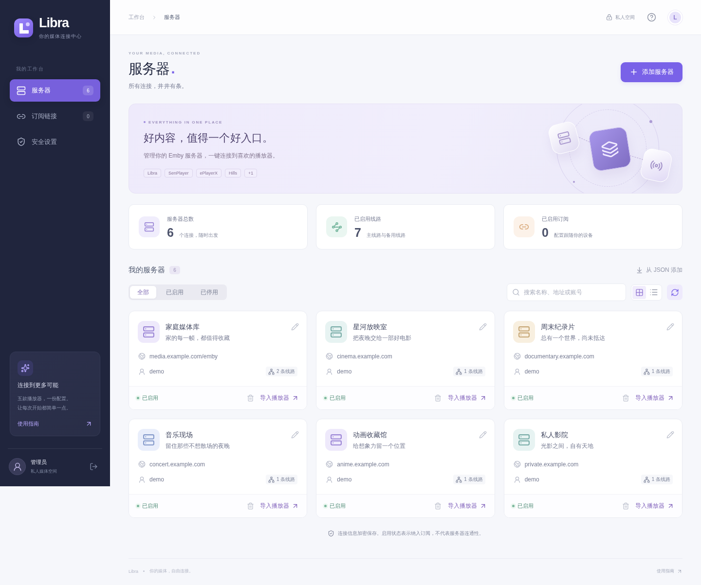

# Libra

你的媒体，自由连接。

一个部署在 Cloudflare Workers 上的私人 Emby 服务器管理台。集中维护账号和线路，生成播放器导入链接，或通过可订阅的 JSON 地址分发配置。界面为独立设计，支持手机与桌面。

本项目与同名 **Libra 播放器**是独立项目。

[](https://deploy.workers.cloudflare.com/?url=https://github.com/cloudberry99/libra)



## 功能

- Emby 服务器的添加、编辑、删除、启停、搜索，以及单条 JSON 配置导入。
- 主线路、最多 32 条备用线路、备注和可选 Logo；支持局域网、IPv6、端口与反向代理路径。
- Libra、SenPlayer、ePlayerX、Hills 和 RodelPlayer（小幻播放器）的 URL Scheme 导入。
- 多条公开订阅：全部或指定服务器、随机或自定义后缀、停用、删除、更换后缀。
- 订阅二维码、复制链接、下载二维码。二维码完全在浏览器本地生成。
- 删除或更换订阅后释放旧后缀，允许重新分配。
- 单管理员、强密码、加密 KV 存储、登录限流、HttpOnly 会话与跨站请求保护。

## 部署到 Cloudflare

需要一个 Cloudflare 账号。使用 Workers，无需 VPS、数据库服务或单独部署前端。

### 一键部署

1. 点击上面的部署按钮，关联 GitHub 账号并创建仓库。
2. 设置 Worker 名称和 `APP_SECRET`。使用密码管理器生成至少 32 位随机密钥，推荐 64 位十六进制字符串；也可以在本机执行 `openssl rand -hex 32`。
3. 构建命令填写 `npm run build`，部署命令填写 `npm run deploy`。Node.js 使用 24。
4. 部署完成后访问 Worker 首页，输入同一份部署密钥，设置自己的管理密码。

KV 绑定名称为 `LIBRA_KV`。仓库中的配置没有任何账号 ID 或 KV ID，Wrangler 会在首次部署时自动创建并绑定 KV；以后部署复用已有绑定。参见 Cloudflare 的[资源自动配置说明](https://developers.cloudflare.com/workers/wrangler/configuration/#resource-provisioning)和[部署按钮说明](https://developers.cloudflare.com/workers/platform/deploy-buttons/)。

`APP_SECRET` 是 **Worker 运行时 Secret**，同时用于首次初始化验证和数据加密。不要仅将它作为构建环境变量设置，也不要提交到 Git。部署按钮会依据 `.dev.vars.example` 提示配置 Secret。

### Fork 后连接 Git 仓库

在 Cloudflare 控制台中进入 **Workers & Pages → 创建应用 → 导入仓库**，选择 Fork 后的项目，根目录保持 `/`，使用上述构建与部署命令。

在 Worker 的 **设置 → 变量和机密** 中添加 `APP_SECRET`，类型选择 Secret；首次部署如果提示缺少必需 Secret，添加后重新部署即可。关联完成后，向所选分支推送代码即可触发更新。

如果已经用 CLI 部署本项目，可在现有 Worker 的构建设置中连接仓库。保持 Worker 名称、KV 绑定和 `APP_SECRET` 不变，就能保留现有数据。

### CLI 部署

```bash
git clone https://github.com/cloudberry99/libra.git
cd libra
npm ci
npx wrangler login
npx wrangler secret put APP_SECRET
npm run deploy
```

首次设置 Secret 时，Wrangler 可能提示创建尚不存在的 Worker，按提示创建即可。不要把密钥直接写进命令行参数。

首次打开页面时没有默认管理密码。必须提供部署密钥才能初始化，避免公开上线后被第一个访客注册。管理密码需要 8–128 位，包含字母、数字和符号。

## 使用

1. 在「服务器」添加 Emby 主地址、账号与备用线路。
2. 点击卡片上的「导入播放器」，选择当前设备已安装的播放器。也可以复制导入链接。
3. 在「订阅链接」创建链接，为客户端选择全部服务器或指定服务器。
4. 复制订阅地址，或打开二维码让客户端扫描。二维码中是完整订阅 URL，并非服务器配置本身。

停用服务器只会将其移出订阅响应，卡片仍可手动生成播放器链接。「全部服务器」订阅会自动包含以后新增的已启用服务器；「指定服务器」按选择顺序返回。

公开链接没有登录验证，**持有链接的人可以读取其中的账号密码**。随机后缀默认使用 128 位随机数；自定义后缀允许 8–64 位字母或数字，包括纯字母、纯数字。请妥善保管链接与二维码。

删除、更换后缀后，旧后缀可以重新分配。如果重新分配，仍持有旧链接的客户端会读取新订阅对应的配置。

## 订阅接口

```http
GET https://your-worker.workers.dev/<suffix>
```

成功返回 `200 application/json`，响应是配置数组；不存在、已删除或停用返回 `404`。没有已启用服务器时返回 `[]`。支持 `HEAD`、`OPTIONS` 和跨域 GET，不依赖 Cookie。响应设置 `Cache-Control: no-store`。

以下全部是虚构示例：

```json
[
  {
    "type": "emby",
    "name": "家庭媒体库",
    "note": "家庭影音",
    "logo": "https://example.com/logo.png",
    "credentials": { "username": "demo", "password": "example-password" },
    "primary": { "url": "https://media.example.com:8920/emby", "name": "主线路" },
    "alternates": [
      { "url": "http://192.168.1.10:8096", "name": "家中直连" },
      { "url": "https://backup.example.com/emby", "name": "白线路" }
    ]
  }
]
```

必填字段只有 `type: "emby"` 和 `primary.url`。服务器名称、备注、Logo、账号、密码、线路名称与备用线路都可以省略。每条备用线路必须提供 `url`，最多 32 条。空 Logo 不输出字段。

密码原样保留，包括首尾空格、中文、`&`、`+`、`#` 和 `%`。省略密码与显式 `""` 不同；编辑页面的「在配置中提供密码」控制是否输出此字段。其他展示字段去除首尾空白。

线路只接受完整 HTTP(S) 基础地址，禁止内嵌账号密码、查询参数、fragment、未编码空白和反斜杠。端口为 1–65535。域名大小写、默认端口、末尾斜杠会规范化；规范化后重复的线路保留第一条。备用线路应指向同一台可信 Emby 服务器，本项目不验证服务器身份或连通性。

响应只包含上述客户端配置，不包含后台记录 ID、版本、启停状态或登录会话。

## 播放器协议

| 播放器      | 导入入口                           | 支持范围与说明                                                                  |
| ----------- | ---------------------------------- | ------------------------------------------------------------------------------- |
| Libra       | `libra://import/server?v=1&data=…` | UTF-8 JSON → Base64URL（无填充）；保留所有线路和凭据，按 v1 规范排除 Logo       |
| SenPlayer   | `senplayer://importserver?…`       | 服务器名称、备注、图标、账号、完整主地址及备用线路                              |
| ePlayerX    | `eplayerx://add-or-update?…`       | 名称、备注、账号、主地址、备用线路；备用地址或名称含原始逗号/分号时提示手动处理 |
| Hills       | `hills://import?…`                 | 主地址拆分为 scheme/host/port，附账号和备用线路                                 |
| RodelPlayer | `rodelplayer://import?…`           | 与 Hills 同类参数，界面名称为小幻播放器                                         |

Libra 适配依据使用者提供的 v1 协议，解析链接后由播放器展示添加表单。其余四种适配参考公开的 [emby-keepalive 协议生成逻辑](https://github.com/SolarisAA/emby-keepalive)，独立实现，不复制其界面或业务代码。

Hills / RodelPlayer 已知参数未明确支持主线路的反向代理基础路径。本项目遇到 `/emby` 这类主线路时会提示手动导入，避免静默丢掉路径。其他播放器未定义的字段不会随意附加。五种 Scheme 均有编码测试，但没有在真实 iOS/Windows 播放器中自动验证；播放器版本可能影响接收行为。

## 安全与存储边界

- 全部业务数据存储在 `LIBRA_KV`，按服务器、订阅和会话分别存储。
- 服务器与其他记录使用 AES-256-GCM 加密，随机 IV，并绑定 KV 键名作为附加认证数据。密钥从部署 Secret 派生。
- 管理密码保存为随机盐 + PBKDF2-SHA256 校验结果，使用 100,000 次迭代及部署 Secret 提供的 HMAC pepper；不会保存明文管理密码。
- 会话使用 256 位随机令牌，KV 中只以其 SHA-256 摘要索引，最长 12 小时。HTTPS 下 Cookie 带有 Secure、HttpOnly、SameSite=Strict。
- 写接口校验同源 Origin、自定义请求头与 JSON 类型；请求体上限 128 KB。前后端均校验配置。
- 登录和公开接口使用 Cloudflare Rate Limiting binding；限流按 IP、边缘位置近似执行，不是全网强一致计数器。
- 页面禁止被 iframe 嵌入，使用 CSP，不加载第三方脚本、字体或二维码接口。用户填写的远程 Logo 会由浏览器请求，使用 `no-referrer`。
- 管理与订阅响应不缓存、不收录。应用日志只记录固定错误类型，不记录请求体、密码或 URL；Worker invocation logs 与 traces 关闭，避免订阅后缀进入应用访问日志。

**KV 是最终一致存储。** 配置更新、删除、停用、退出登录与密码变更在不同边缘节点传播可能需要一分钟或更久。版本字段能拦截常见过期编辑，但不是原子锁；本项目面向单管理员，不保证并发管理或跨节点写入的强一致性。避免同时在多台设备创建相同自定义后缀。详见 [KV 的一致性说明](https://developers.cloudflare.com/kv/concepts/how-kv-works/)。

撤销订阅不能删除客户端已经拉取的密码。如果配置已经泄漏，需要到 Emby 端更换凭据。

目前限制 200 台服务器、50 条订阅。大批量服务器拉取会消耗多次 KV 读取，请结合 [Cloudflare KV 额度](https://developers.cloudflare.com/kv/platform/limits/)设置合理的客户端刷新频率。

## 备份和恢复

同时备份 KV 数据和 `APP_SECRET`。**重新部署时不要重新生成 APP_SECRET**，否则已有记录将无法解密。不要把这两份备份公开发布。

忘记管理密码时，可以通过有权限的 Cloudflare 控制台，仅删除 `LIBRA_KV` 中的 `admin` 键，再凭原有部署密钥重新初始化。不要删除服务器和订阅记录；旧会话会因新的管理员版本失效。KV 的传播延迟同样适用于此操作。

## 本地开发与验证

使用 Node.js 24（最低 22）。

```bash
npm ci
cp .dev.vars.example .dev.vars
# 编辑 .dev.vars，填写独立的本地 APP_SECRET
npm run dev
```

Wrangler 会为本地开发创建隔离的 KV。修改前端后重新运行构建即可更新内嵌资源；不要将本地开发绑定到生产 KV。

```bash
npm run check
npx playwright install --with-deps chromium
npm run test:browser
npx wrangler deploy --dry-run
```

测试覆盖配置校验、Unicode 和特殊字符、五种 Scheme、密码与加密、鉴权与 CSRF、限流、订阅数据范围、更新删除和后缀复用。浏览器测试使用独立的临时 Worker / KV，覆盖首次初始化、添加服务器、搜索、播放器链接、订阅、二维码实际解码与下载，以及 1440 px / 390 px 界面。

前端使用 React、Lucide 与本地二维码库；构建时将哈希命名的 JS/CSS 内嵌为 Worker 静态响应，只需部署一个 Worker。业务数据始终通过 KV 绑定访问，不依赖浏览器存储。

```text
src/client/        界面与响应式样式
src/shared/        客户端配置校验、播放器协议
src/worker/        路由、认证、加密与 KV
scripts/           构建与临时浏览器测试服务
tests/             协议、安全、接口与浏览器测试
wrangler.jsonc     可直接 Fork 的 Cloudflare 配置
```

许可证：[MIT](LICENSE)。
